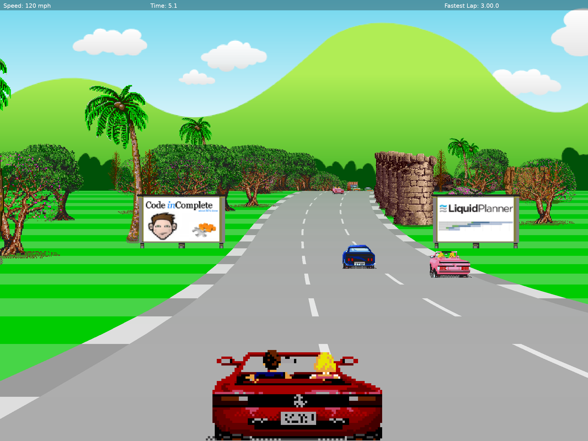

# rust-racer

An OutRun-style pseudo-3D racer: a Rust port of Jake Gordon's
[javascript-racer](https://github.com/jakesgordon/javascript-racer) (v4, "final") built on
[game-toolkit](https://github.com/sunsided/game-toolkit), with the simulation running in a
[sillyecs](https://github.com/sunsided/sillyecs) world.
[Play it in the browser](https://sunsided.github.io/rust-racer/play/), or
[read how it works](https://sunsided.github.io/rust-racer/).



```sh
cargo run --release
```

Arrow keys / WASD (or a gamepad) drive, M toggles the music, Esc quits.

## How it's put together

The [book](https://sunsided.github.io/rust-racer/) (sources in `book/`, `task book` to serve it
locally with `mdbook`) explains the pseudo-3D rendering, the driving and traffic, and the Rust side in
detail. In short:

- `ecs.yaml` describes the world; `build.rs` generates it with sillyecs. Cars and the player
  are entities. The track, controls, per-segment traffic grid, player view, background scroll
  and lap times are separate states, so each system declares exactly what it reads and writes.
  Seven systems run in the 60 Hz `FixedUpdate` phase: `Traffic` (AI steering and movement),
  `TrafficIndex` (buckets cars into segments), `Driving` (the player's controls),
  `Collision`, `LapTimer`, `Parallax` and `Snapshot` (publishes the player car).
  Each component, state and system lives in its own module under `src/ecs/`.
- `src/track.rs` builds the road and scenery, `src/render.rs` projects and draws it, the road
  as filled quads.

In the browser: `task web` serves a live-rebuilding build at http://localhost:8080, and
`PROFILE=release task web:build` builds into `dist/`. Both need `trunk`
(`cargo install trunk --locked`) and the `wasm32-unknown-unknown` target. The music starts with
the first key press, since browsers keep audio muted until then. Run `task assets:manifest`
after adding files to `assets/`, so the web build preloads them.

## License

Copyright © 2026 Markus Mayer

The code is triple licensed under your choice of either of:

- European Union Public Licence, Version 1.2, ([LICENSE-EUPL](LICENSE-EUPL)
  or https://joinup.ec.europa.eu/collection/eupl/eupl-text-eupl-12)
- Apache License, Version 2.0, ([LICENSE-APACHE](LICENSE-APACHE) or http://www.apache.org/licenses/LICENSE-2.0)
- MIT license ([LICENSE-MIT](LICENSE-MIT) or http://opensource.org/licenses/MIT)

The art and music in `assets/` are not covered by this; see the credits below.

## Credits

Game design, graphics and music are from
[javascript-racer](https://github.com/jakesgordon/javascript-racer),
Copyright (c) 2012-2016 Jake Gordon and contributors, MIT licensed. See
[LICENSE-javascript-racer](LICENSE-javascript-racer).
